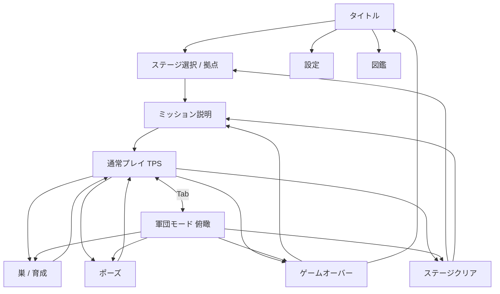

# GOKI TAKEOVER — 統合開発仕様書 v1.0

> ゴキブリ侵略サバイバル / Unity・Windows PC向け / 軽量3D / 個人開発 / 外部有料アセット不要
>
> 作成日：2026-10-22　仕様状態：初版（開発着手用）
>
> **重要：** 本仕様書は「完成版の方向性」と「今のPCで動作確認しながら作る段階的な実装計画」を分離している。各フェーズの完了条件を満たすまで次に進まず、性能の実測に応じて表示数・演出・AI更新頻度を調整する。

---

## 0. 本仕様書の使い方

- 開発担当：Codex / Claude Code 等のコーディング支援 + Unity Editorでのユーザー検証。
- 開発開始時は、同梱の `GOKI_TAKEOVER_開発開始プロンプト.md` を最初に渡すこと。**この仕様書も一緒に参照**させる。
- 未確定の仕様は「暫定値」として実装し、Inspector / ScriptableObject から変更可能にする。
- 既存のUnityプロジェクトがあればその状態を先に調査し、**既存ファイル・シーン・アセットを勝手に消さない／壊さない**。
- 新規プロジェクトならフェーズ1に必要な最小構成から作る。フルゲームを一度に生成しようとしない。
- このパッケージに含まれるPNGは**完成画面を約束する3D素材ではなく、コンセプトアート／UI構成参考**。画像そのものをゲーム背景に貼って完成扱いしない。特に照明・反射・多数のゴキブリ表現は今のPC向けに簡略化する。

## 1. 企画概要

| 項目 | 内容 |
|---|---|
| 正式名称（仮） | **GOKI TAKEOVER** |
| 日本語サブタイトル | ゴキブリ侵略サバイバル |
| ジャンル | 軽量3D潜入アクション × コロニー育成 × 軍団指揮 × コミカルな人間パニック |
| 対象 | Windows PC、キーボード＋マウス、オフライン1人用 |
| 画面比率 | 16:9基準、UIは解像度に追従 |
| 視点 | 三人称（ゴキブリ背後）と見下ろし戦術視点を `Tab` で切替 |
| プレイ単位 | 1つの建物／エリアを侵略して制圧するステージ制 |
| 雰囲気 | ホラーや写実的な虫表現より、少し生意気でコミカルなローポリ3D |
| 主な魅力 | 1匹から始まり、巣・仲間・縄張りを増やし、人間を退去させる逆転劇 |
| 優先事項 | **完全無料の基本アセット制作、軽量性、動かして遊べること** |

### 1.1 プレイヤー体験

1. ゴキブリ1匹として屋内に侵入し、巨大な家具や人間に囲まれて探索する。
2. 見つからないよう食料を回収して巣に持ち帰る。
3. 食料を使って自分・巣・仲間を強化する。
4. 戦術視点で仲間に探索・回収・防衛・侵攻を指示する。
5. 人間がゴキブリを発見すると、叫ぶ／追いかける／駆除グッズを置く等のリアクションをする。
6. 食料確保・縄張り支配・人間の恐怖の条件を満たすと、最後の駆除作戦イベントへ。
7. 駆除作戦を生き残り、人間が撤退すればステージクリア。

### 1.2 ゲームの柱

- **潜入：** 障害物の隙間、家具の裏、壁際、後に壁・天井を使って人間の視界から逃げる。
- **生存：** HP、発見ゲージ、駆除グッズ、逃走手段。
- **繁殖：** 食料リソース、巣、仲間、アップグレード。
- **侵略：** エリア単位の縄張り支配と戦術指示。
- **反応：** 人間がプレイヤーの行動に応じて警戒・攻撃・パニックを起こす。

### 1.3 対象外（初期実装ではやらない）

オンライン協力／対戦、オープンワールド、機械学習型の人間AI、リアルタイム数百匹の個別AI、フォトリアルな描画、複雑な物理破壊、生成AI APIの常時呼び出し、有料3D生成サービス、外部課金機能、VR対応。

---

## 2. 実機・開発予算制約（最重要）

### 2.1 想定開発PC

- ASUS UX534FAC 系のWindowsノート。
- メモリ：16GB。
- GPU：Intel UHD Graphics（CPU内蔵GPU）。
- CPU型番はプロジェクト着手時に確認。過去の機種の代表スペックを確定値として決め打ちしない。
- ユーザー提供のタスクマネージャー画像では、メモリ使用量が **13.6 / 15.8GB（約86%）** だった。Unity起動前に不要なソフトを閉じることを推奨。
- 3D描画負荷に加え、エディターとブラウザ／AIツールの同時使用によるメモリ逼迫が懸念。

### 2.2 パフォーマンス目標（保証値ではなく合格ライン）

| 項目 | 初期ターゲット | 判定方法 |
|---|---|---|
| 実行環境 | Windows 64-bitのスタンドアロンビルド | 実機起動 |
| 画面解像度 | 1280×720 | ビルド設定 |
| 目標FPS | **30fps以上**（通常プレイ） | ビルド実測、継続プレイ |
| フレーム時間目標 | 33.3ms以下を基本 | Unity Profiler |
| ステージ | 最初はキッチン1部屋 | 移動・カメラ検証 |
| 人間AI | 1体から開始 | 発見・追跡・リセット |
| 仲間ゴキブリ | 主人公＋仲間4〜9匹で開始 | 上限をInspector設定 |
| 複数部屋・大群 | 後半フェーズの性能検証後 | 段階的負荷試験 |

**判定の原則：** エディターでのFPSだけでは合否を確定しない。スタンドアロン実行、同一シーン・同一操作で比較する。低スペックPCでの動作は実機検証前に断定しない。

### 2.3 描画方針

- レンダーパイプラインは**新規プロジェクトでは軽量設定のURPを第一候補**とする。既存プロジェクトがBuilt-inなら、むやみに移行しない。**HDRPは採用しない**。
- Unityのインストール済みLTS系・実プロジェクトのバージョンに合わせてAPIとパッケージを選ぶ。
- メッシュは低ポリゴン、マテリアルは少数、できるだけ共通マテリアルを利用する。
- ベイク照明や簡易ライトを主軸とし、リアルタイム影を原則無効／最小化。
- ポストプロセス、SSAO、ボリュームライト、高級反射、過度な透明表現を初期OFF。
- 画面内のゴキブリはシンプルな共通モデル＋色差・サイズ差で表現。
- オブジェクトプールで仲間・食料・パーティクルを再利用。
- 遠距離の仲間は低頻度更新／モデル簡略化／群れ代理表現。
- 戦術視点と三人称視点の**2台カメラを同時レンダリングしない**。切替で一方のみ有効にする。
- UIはCanvasの不要な全体再構築を避け、変化する数値を個別更新。
- 音声は短い無料・自作素材を使い、過大な常駐メモリを避ける。

---

## 3. 無料3Dキャラクター生成（決定事項）

### 3.1 採用方式

**Blender必須ではない。Unity標準プリミティブ＋C#でデフォルメ3Dゴキブリを自動生成する。** 有料Meshy / Tripo等は使わない。

- Unity Editorのメニュー `Tools > GOKI TAKEOVER > Generate Cockroach` から1クリック生成できるEditorスクリプトを実装。
- `GameObject.CreatePrimitive` などで低ポリの球体・カプセル・円柱を作り、必要に応じて独自の軽量メッシュをコードで構築。
- 親オブジェクト `CockroachRoot` の下に部位を整理して配置し、再生成しても重複しない。
- 完成物を `Assets/_GokiTakeover/Prefabs/Cockroach_Player.prefab` に保存する（Editor APIが使える場合）。
- 実装環境がUnity Editorを実行できない場合は、スクリプトを作成し、**ユーザーがUnityのメニュー操作で生成できる形**まで提供する。実際に動作確認したと偽らない。

### 3.2 必要な部位

| パーツ | 数 | 形状・動作 |
|---|---:|---|
| 胴体 | 1 | 茶系の楕円体。前後方向は長め |
| 頭 | 1 | 小型の球／楕円、胴体前方 |
| 甲殻／翅カバー | 2 | 胴体上に左右対称に乗せる |
| 脚 | 6 | 左右各3本。股・中間・先端の階層（少なくとも2節） |
| 触角 | 2 | 細い節・棒状パーツを複数接続、ゆっくり揺れる |
| 目 | 2 | 大きすぎないコミカルな黒い目 |
| 顔パーツ | 必要最小 | 省略可。表情は角度や触角で表す |

**プロポーション方針：** 参考デザインに近い「茶色い甲殻＋目＋長い触角＋6本脚」。かわいすぎず、虫らしさは残し、写実的な不快感は弱める。

### 3.3 アニメーション

| アニメーション | 最低仕様 | 実装順 |
|---|---|---|
| Idle | 触角の左右揺れ、軽い胴体上下動 | Phase 1 |
| Walk | 左前＋右中＋左後 と 右前＋左中＋右後の交互脚動作（tripod gait） | Phase 1 |
| Run | 歩行周期アップ、胴体前傾 | Phase 1 |
| Eat / PickUp | 頭部を食料側へ下げる | Phase 2 |
| Hit / Die | 短いのけぞり、倒れる | Phase 2 |
| Climb | 接地面に胴体を沿わせる動作 | Phase 3 |
| Cheer | 勝利ポーズ／触角を上げる | Phase 6 |

- 基本はC#で子Transformのローカル回転を制御。後からAnimationClip差し替え可能な設計にする。
- アニメーションの更新は画面に見えるキャラクター中心。
- 生物学的正確さより操作感と可読性を優先。

### 3.4 モデルの再利用

- 主人公と仲間は**同じ基本メッシュ構造**を使い、色・大きさ・模様・速度等のデータ差分で派生。
- 仲間は主人公と別々に大量のマテリアルを複製しない。
- モデル生成時のパーツ数が多すぎて描画負荷になる場合、脚・触角を統合メッシュ化する最適化を後続フェーズで検討。
- FBX出力は必須ではない。PrefabがUnity内で利用できれば完成とする。

---

## 4. プレイヤー操作・カメラ

### 4.1 キー割当（変更可能）

| 入力 | 通常（三人称） | 軍団（見下ろし） |
|---|---|---|
| W/A/S/D | ゴキブリ移動 | カメラ平行移動 |
| マウス移動 | 視点回転 | ポインター選択 |
| Shift | ダッシュ | 押している間、カメラ移動高速化 |
| E | 状況に応じた回収・食事・預ける・操作 | 選択中ターゲットの詳細／指示確認 |
| Space | 小ジャンプ／段差越え（後半の強化対象） | カメラを選択対象へ戻す |
| Tab | 軍団モードに切替 | 通常モードに戻る |
| 1 / 2 / 3 / 4 | クイック操作（後半） | 回収／探索／防衛／一斉侵攻 |
| 左クリック | インタラクト対象確認（任意） | 仲間／グループ選択・目標指定 |
| 右クリック | 任意の簡易アクション | 移動目標・経路指定／選択解除 |
| Esc | ポーズ | ポーズ |

※ゲームプレイ開始時に入力設定を確定。新Input Systemか旧Input Managerかは既存プロジェクト構成に合わせ、混在させない。

### 4.2 通常モード（TPS）

- カメラは主人公背後・低い目線。巨大な家具の脚や落ちた食料を目立たせる。
- 接地面に対する身体の向きは滑らかに変化。
- 壁際、家具裏、暗所の安全地帯が見分けられるよう、色味・HUDでヒントを出す。
- インタラクト可能な食料が近い場合のみ `E 回収` を表示。
- 主人公のHP、発見度、食料の所持状態、現在の短期ミッションを表示。

### 4.3 軍団モード（俯瞰）

- `Tab` で専用俯瞰カメラに切替、室内をミニチュアとして見渡す。
- 画面内だけを表示し、必要な壁は半透明化または非表示にして視界を確保。
- 主人公・仲間・巣・食料・トラップをアイコン／色で区別する。
- 選択した仲間に一括指示：回収／探索／防衛／一斉侵攻。
- **切替でゲーム時間は止めない**（初版）。プレイヤーが軍団モード中でも人間は行動する。
- 将来、操作難易度が高い場合のみ「指示中は低速」のアクセシビリティ設定を追加検討。
- 俯瞰視点を3Dで表現するのが高負荷なら、簡易フロアメッシュとアイコン重視の描画に切替可能にする。

### 4.4 壁・天井移動

- 完成版の特徴として実装。**Phase 1では床上移動を先に完成**させる。
- Phase 3で壁面クライミングを実装。レイキャストで面法線を検知し、重力・姿勢・移動方向を切替える。
- 天井移動は壁登り安定後に追加する。
- 角・縁・天井移行時にカメラ酔いしないよう回転補間を設定。
- Rigidbody / CharacterControllerを複数重複させない。コリジョンは単純な当たり判定から開始。
- 仲間AIの壁登りは初期対象外（専用ウェイポイントやトンネルで近似）。

---

## 5. 食料・所持・巣

### 5.1 食料の種類と役割

| 種類 | 初期回収量（暫定） | 備考 |
|---|---:|---|
| パンくず | 1 | チュートリアルの主要アイテム |
| 米粒 | 1 | 小型・拾いやすい |
| お菓子 | 2 | やや見つかりやすい位置 |
| 食べ残し | 3 | 大型・運搬力が必要な設定にできる |
| 生ごみ | 2 | リスクと報酬を変化させる |

- 地面の食料に近づいて `E` で回収 → 主人公が「持っている」状態になる。
- 初期運搬容量は食料1個。運搬中は速度を少し下げてもよい。
- 巣に戻り `E` で納品したらコロニー食料資源が加算される。
- `食べる` は回収とは別目的（HP・スタミナなど）で、メニュー／長押し等による誤操作防止を付ける。最初のMVPでは「回収／納品」に絞る。
- 初回ステージは「パンくず3個を納品する」という短期ミッション。
- 必要数が不足しないよう、マップ配置総数または補充ロジックを保証する。

### 5.2 巣

- 初期拠点は冷蔵庫裏などの隙間にある小さな巣。
- 巣内に入ると巣メニューを開ける（出撃・強化・繁殖・状況確認）。
- 食料は共通リソース。将来的にフェロモン等の第2資源を追加可能。
- `NestData` にレベル、最大仲間数、保有食料、解放施設、拡張段階を持つ。
- 再出撃地点／HP0時の復活地点として機能する。

### 5.3 繁殖

- 仲間を増やす際に食料を消費。最初の試験値：食料3で仲間1匹追加。
- 最初は手動ボタンで増員し、一定上限を設定（まず仲間4〜9匹）。
- 個体ごとの複雑な遺伝や交配は実装しない。
- 仲間は共通Prefabとパラメータによる軽量AIで活動。

### 5.4 アップグレード

| 強化名 | 効果 | コスト例（暫定） |
|---|---|---:|
| 移動速度 | 歩行／ダッシュ速度上昇 | 食料5 |
| 運搬力 | 回収容量または運搬ペナルティ改善 | 食料5 |
| 隠密性 | 発見ゲージの上昇を低減 | 食料6 |
| 繁殖力 | 仲間上限・増員コスト改善 | 食料8 |
| 耐久力 | HP上限アップ | 食料6 |
| ジャンプ強化 | 段差・回避能力アップ | ステージクリア解放 |

- 効果・コスト・レベル最大値はScriptableObjectで外だし。
- 強化ボタンで残高不足なら何も消費せず、理由を明示。
- 序盤は「移動速度」「隠密性」を先行実装し、他はフェーズに従って追加。

---

## 6. 人間AI・パニック

### 6.1 AI状態遷移

```text
Routine（生活／巡回）
  ├─ 異音を感知 → Suspicious（警戒）
  ├─ ゴキブリを視認 → Chase（追跡）
  └─ 被害の蓄積 → Countermeasure（駆除対策）
Suspicious
  ├─ 再発見 → Chase
  └─ 見失う／時間経過 → Routine
Chase
  ├─ 近距離 → Attack（スリッパ等による攻撃）
  └─ 見失う → Search（捜索）→ Routine
Countermeasure
  ├─ トラップを設置／点検 → Routine
  └─ 大量発生 → Panic（恐怖）
Panic
  ├─ 恐怖度が高い → Flee（避難）
  └─ 恐怖度低下 → Countermeasure / Routine
```

- `HumanAIController` は状態機械で実装。最初のMVPはRoutine / Chase / Searchだけでよい。
- 人間の移動は床面NavMeshまたはルート巡回ウェイポイントで実装。
- 感知は視野角・最大距離・遮蔽レイキャストで判断。初期パラメータはデータ化。
- ゴキブリが棚や家具の下に潜れば見失う。狭い場所では人間の当たり判定を入れない。
- サーチ状態を一定時間続けた後、元の巡回に戻る。
- クールダウンや攻撃予兆を設け、即死や理不尽な追撃にならないようにする。

### 6.2 反応段階（後半フェーズ）

| 反応レベル | きっかけ | 行動 |
|---|---|---|
| 0 平和 | 未発見 | 食事・移動など通常生活 |
| 1 発見 | 初回視認 | 驚く・叫ぶ・スリッパを取りに行く |
| 2 警戒 | 発見が複数回 | 巡回強化・トラップを追加 |
| 3 パニック | 巣の拡張・仲間増加 | 逃げる・家具周辺の駆除を強化 |
| 4 駆除業者 | 侵略終盤 | 最終防衛イベント開始 |
| 5 撤退 | 駆除失敗・侵略成功 | 人間が建物から退去、クリア演出 |

- 「AI学習」はクラウドAIではなく**履歴に基づくルール処理**で実現する。
- 例：最後にゴキブリを見たエリアの通過回数が高い → 一定確率でそこへトラップを配置。
- 同じトラップに集中する偏りを防ぎ、詰み状態を作らない。

### 6.3 人間パニックの演出

- 小さな悲鳴・吹き出し・大げさな足の動き・スリッパ攻撃・逃走などでコミカルに表現。
- 血やグロテスクな表現は不要。
- テキストは日本語。字幕・吹き出しをOFFできる設定を用意。

---

## 7. 駆除グッズ・危険

| 種類 | 基本ギミック | 対処方法 | 実装段階 |
|---|---|---|---|
| スリッパ | 人間が予兆→範囲攻撃 | ダッシュで退避／家具下へ | Phase 2 |
| 粘着シート | 侵入で速度低下／拘束 | 回り道／仲間救出は将来 | Phase 2 |
| 殺虫スプレー | 前方扇形の継続ダメージ | 障害物越しに回避 | Phase 4 |
| 毒餌 | 食料に似ているがダメージ | 目印の危険察知・探索 | Phase 4 |
| 燻煙剤 | 制限時間付きの部屋全域危険 | 別区画へ撤退／巣防衛 | Phase 5以降 |
| ロボット掃除機 | 巡回移動する危険な障害物 | タイミングを見て回避 | 拡張候補 |

- `HazardBase` 共通インターフェースでダメージ、警告UI、発動条件、再使用間隔を管理。
- トラップはプレイヤーの移動経路を完全遮断しない配置制約を持つ。
- チュートリアルでは危険アイコンと救済的な初回説明を表示。

### 7.1 HP0・失敗

- 主人公HPが0になると「やられた」画面。
- MVPは「リトライ」または「タイトルへ」を選択。
- 完成版では巣に仲間・食料が残る場合、一定コストで後継のゴキブリに交代可能。
- セーブの扱いは「ステージ開始時チェックポイント」＋「クリア・巣での確定保存」を基本とし、進行が意図せず失われないようにする。

---

## 8. 仲間AI・戦術指揮

### 8.1 仲間の基本状態

`Idle`, `FollowLeader`, `GoToTarget`, `CollectFood`, `ReturnToNest`, `DefendNest`, `FleeHazard`, `Disabled`。

- 仲間の行動は人間より単純な状態機械で十分。
- 近距離の仲間は個別移動。遠くの仲間は簡易ウェイポイント・代表経路に従う。
- 経路再探索は毎フレームしない。例：0.2〜0.5秒以上の間隔を持ち、個体ごとに更新タイミングをずらす（**暫定値**）。
- 同じ集団は目標地点・ルートを共有し、GPU・CPU負荷を抑える。
- 仲間の接触判定や衝突計算は最小限にし、隊列は視覚的なオフセットで近似可能。

### 8.2 コマンド

| コマンド | 期待する動作 | 失敗／例外時 |
|---|---|---|
| 回収 | 指定食料に移動 → 持ち帰り → 納品 | 食料枯渇なら待機・別候補へ |
| 探索 | 未調査ポイントへ移動 → 情報開示 | 道がないならキャンセル表示 |
| 防衛 | 巣周辺で危険を回避し待機／守る | 退避が優先 |
| 一斉侵攻 | 選択グループが指定位置へ集結 | 到達不能なら最寄り安全地点 |

- 「侵攻」は人間への直接攻撃より、縄張りを支配して食料や巣を確保する行動とする。
- 仲間がトラップに突っ込み続けないよう、危険エリアに高い通行コストを設定。
- プレイヤーの指定命令より**生存回避が優先**される場合があることをUIで示す。

### 8.3 大群の見せ方

- 最初は主人公＋仲間4〜9体を個別AIで確認。
- 同時20体などを拡張する際はProfiler測定後に上限を変更。
- 100匹以上の「大群」は個別AIではなく、近くを可視個体・遠方を簡易演出にすることを検討。
- 上限数は固定で保証しない。GPU描画回数、CPU AI処理、メモリの実測で決定。

---

## 9. ステージ・進行

### 9.1 ステージ一覧（完成版計画）

| ステージ | 舞台 | 特徴 | 難易度目安 |
|---|---|---|---|
| Stage 1 | 一人暮らしのワンルーム | 1人の人間、キッチン・テーブル・冷蔵庫裏 | 初級 |
| Stage 2 | 4人家族の一軒家 | 複数部屋・複数人・ペット | 中級 |
| Stage 3 | 飲食店 | 大量の食料、営業時間、衛生対策 | 中〜上級 |
| Stage 4（拡張） | 大型スーパー | 広い売り場・倉庫・冷蔵室 | 上級 |
| Stage 5（拡張） | スマート住宅 | ロボット掃除機・監視など | 上級 |
| Final（拡張） | 駆除会社の施設 | 特殊トラップ・最終戦 | 高難度 |

- **最初に制作するのはStage 1のキッチン1部屋だけ。** Stage 1全域へ広げた後、2・3へ展開。
- ステージの拡大で高負荷になる場合、各部屋を区切ってロードする。

### 9.2 短期ミッション（チュートリアル）

1. 3Dキッチンでゴキブリを操作する。
2. パンくず3個のうち1個を回収する。
3. 巣に戻って納品する。
4. 人間に見つからず同じ行動を繰り返す。
5. 納品3個達成で「練習クリア」表示。

### 9.3 正式なステージ制圧条件

正式版では下記**3つの進行ゲージが各100%**に達すると最終防衛イベントが解放される。

1. **食料確保率：** ステージ既定の納品目標値に対する割合。
2. **縄張り支配率：** 必須エリアで巣／仲間／占領行動を一定時間維持した割合。
3. **人間の恐怖度：** 発見・コロニー拡大・食料被害などによる累積。行動で下がる／上がる調整可能。

その後、駆除業者などの**最終防衛イベントを一定時間耐え、少なくとも主人公またはコロニー存続条件を満たした状態**で人間撤退→クリアとする。

**注意：** 食料を「部屋内の全食料」から厳密に100%回収することは要求しない（取り逃しによる詰み防止）。ゲージの計算対象と数値はStageDefinitionで管理。

### 9.4 コンテンツ開放

- ステージクリアで次ステージの解放。
- 評価A/B/Cは制圧所要時間・発見回数・生き残り数・食料回収量から計算（式は後でバランス調整）。
- クリア報酬で新能力（例：ジャンプ強化）や見た目の色違いを解放。

---

## 10. UI／画面構成・遷移

### 10.1 デザイン原則

- UI文言は**日本語**。
- 参考画像と同様の黒／焦げ茶のパネル、黄緑・橙のアクセント、少し乱雑なブラシ風グラフィック。
- ただし実プレイの視認性が最優先。背景の3Dを見えなくするUI装飾を減らす。
- フォントは無料で利用できる日本語書体を適切なライセンスに従って使用。ゲームに同梱する場合の再配布条件を確認。
- 画面基準は1920×1080のレイアウト比率だが、実行は1280×720を初期検証値とし、小さい文字が読めるか必ず確認。
- 色だけで危険を区別せず、アイコン＋文字表示を併用する。
- UIは仮置き→操作検証→装飾の順に制作。

### 10.2 主要画面（12種類）

| No. | 画面 | 主な表示・操作 | デザイン参照 |
|---:|---|---|---|
| 01 | タイトル | ゲーム開始・つづきから・設定・図鑑・終了 | `DesignReferences/01_Title.png` |
| 02 | ステージ選択／拠点 | 侵略先、巣レベル、仲間、食料、支配率、出撃 | `DesignReferences/02_StageSelect.png` |
| 03 | ミッション説明 | 目的、危険、人間の人数、操作ヒント | 01/02のUI様式で実装 |
| 04 | 通常プレイ（三人称） | 主人公、ミッション、ミニマップ、HP、発見度、操作ヒント | `DesignReferences/03_ThirdPerson.png` |
| 05 | 軍団モード（俯瞰） | 仲間数、危険度、食料地点、群れ選択、4コマンド | `DesignReferences/04_SwarmTactics.png` |
| 06 | 巣／育成 | リーダー、資源、繁殖、移動速度等の強化、施設 | `DesignReferences/05_NestUpgrade.png` |
| 07 | ポーズ | 再開・操作・設定・タイトルへ戻る | 01のパネル形式 |
| 08 | 設定 | 画質、解像度、音量、キー説明、感度 | 01のパネル形式 |
| 09 | 図鑑 | ゴキブリ能力、敵、食料、駆除グッズ | 02の情報カード形式 |
| 10 | 発見／駆除警告 | 発見ゲージ、人間の状態、危険表示 | 03/04のHUDを利用 |
| 11 | ゲームオーバー | リトライ、巣へ戻る（後半）、タイトル | 06の暗い演出版 |
| 12 | ステージクリア | 支配率、食料、仲間、発見回数、評価、次へ | `DesignReferences/06_StageClear.png` |

### 10.3 画面遷移図



### 10.4 HUD情報優先度

- 通常視点：左上にミッション、右上に小型マップ、左下に資源・仲間、右下にHP・発見度、最下部に操作ヒント。
- 軍団視点：上部に仲間・危険・食料、中央に目標アイコン、下部に4つの指示ボタン。
- 状態更新がない時は必要以上に数字・エフェクトを再描画しない。

---

## 11. Unityプロジェクト構造

```text
Assets/
└── _GokiTakeover/
    ├── Art/
    │   ├── Materials/
    │   ├── Meshes/
    │   ├── Textures/
    │   └── UI/
    ├── Audio/
    ├── Data/
    │   ├── Stages/
    │   ├── Units/
    │   ├── Hazards/
    │   └── Upgrades/
    ├── Editor/
    │   └── CockroachGeneratorEditor.cs
    ├── Prefabs/
    │   ├── Characters/
    │   ├── Environment/
    │   ├── Food/
    │   └── UI/
    ├── Scenes/
    │   ├── Boot.unity
    │   ├── Title.unity
    │   ├── StageSelect.unity
    │   ├── Stage01_Kitchen.unity
    │   └── Result.unity
    ├── Scripts/
    │   ├── Core/
    │   ├── Character/
    │   ├── Camera/
    │   ├── Interaction/
    │   ├── HumanAI/
    │   ├── Colony/
    │   ├── Tactics/
    │   ├── Hazard/
    │   ├── UI/
    │   ├── Save/
    │   └── Performance/
    └── Tests/
        ├── EditMode/
        └── PlayMode/
Docs/
    ├── GOKI_TAKEOVER_統合開発仕様書_v1.0.md
    ├── GOKI_TAKEOVER_開発開始プロンプト.md
    └── DesignReferences/
```

**命名ルール：** クラス名PascalCase、変数camelCase、ファイル名は主要クラス名と一致、Inspector用設定は `[SerializeField] private` を基本とする。Editor専用APIは `Editor/` 以下へ分離。

### 11.1 主な責務分割

| コンポーネント | 責務 |
|---|---|
| `CockroachGeneratorEditor` | Editor上の自動モデル生成・Prefab保存 |
| `CockroachVisualController` | 触角・脚の簡易アニメーション |
| `RoachMotor` | 走行・旋回・ダッシュ・接地判定 |
| `SurfaceClimbController` | 壁／天井への移行（Phase 3） |
| `PlayerInteractor` | 食料などの検出・回収・納品 |
| `ThirdPersonRoachCamera` | 通常視点追従 |
| `TacticalCameraController` | 俯瞰視点移動・ズーム |
| `CameraModeManager` | `Tab` での切替・入力切替 |
| `HumanAIController` | 人間の状態機械・遷移 |
| `HumanSensor` | 視野・遮蔽・発見度 |
| `FoodItem` / `Inventory` | 食料量・保持・納品 |
| `NestController` | 食料・巣レベル・繁殖・復活地点 |
| `ColonyManager` | 仲間生成・人数・上限管理 |
| `RoachFollowerAI` | 仲間のシンプルな行動 |
| `TacticalCommandManager` | グループ選択と指示 |
| `HazardBase` | トラップ・ダメージ・予兆 |
| `StageProgressController` | 食料／縄張り／恐怖の進行ゲージ |
| `GameFlowManager` | 状態・クリア・ゲームオーバー |
| `SaveSystem` | JSON保存・読み込み・バージョン管理 |
| `HudPresenter` | HUD表示の更新 |

- いずれも設計上の名前であり、フェーズ1で全て空実装する必要はない。
- MonoBehaviourへの過度な集中を避け、データ・入力・表示と実際のゲーム状態を切り離す。
- キャラクター設定、ステージ進行量、駆除グッズのパラメータはScriptableObjectを用意する。
- イベント通知は必要最小限。最初から巨大な独自フレームワークは作らない。

---

## 12. セーブ・設定・エラー耐性

- `Application.persistentDataPath` にJSON形式で保存。
- 保存対象：バージョン番号、解放ステージ、評価、取得アップグレード、拠点レベル、設定値、チェックポイント。
- MVPはステージクリア結果や設定保存から着手。ゲーム中の全個体位置までの復元は後回し。
- JSONが読めない場合はバックアップして初期化確認を促す。読み込み失敗でクラッシュさせない。
- マウス感度、サウンド音量、グラフィック設定、キー説明を設定画面から操作。
- クイック画質設定：低（標準）／中。まず低だけが正しく動けばよい。
- `Esc` はポーズ、設定保存、再開の一貫性を保つ。

---

## 13. 開発ロードマップ

> **各フェーズは一度に丸投げしない。** 「実装 → Unityで開く → コンパイル確認 → 動作確認 → 実測 → Gitコミット」の順。

### Phase 0 — 開発環境・安全確認

**作業**
- Unityエディターバージョン／プロジェクト既存構成／レンダーパイプライン／入力方式／Git状態を確認。
- 既存アセットのバックアップ方法を確認し、`Assets/_GokiTakeover/` 以下に実装範囲を限定。
- 必要なIgnore設定：`Library/`, `Temp/`, `Obj/`, `Logs/`, `Build/` 等をGit管理対象から外す。
- 画質初期値を低負荷に設定、1280×720を検証基準にする。

**完了条件**：プロジェクトをエラーなく開ける／安全に新規ファイルを配置できる／Gitで変更差分を確認できる。

### Phase 1 — 動かせるゴキブリ（**最初の依頼範囲**）

**作業**
1. ゴキブリ自動生成EditorメニューとPrefab。
2. 頭・胴体・6本脚・触角2本・目2個、色・大きさの調整。
3. Idle・Walk・Runの簡易アニメーション。
4. 床上でWASD移動、Shiftダッシュ、マウスカメラ回転。
5. 仮の低ポリキッチン1部屋（床・壁・冷蔵庫・テーブル・収納・パンくず位置のマーカー）。
6. テスト用HUD（HP・FPS・移動操作）と、最低限の衝突判定。

**完了条件**
- Unityのメニュー操作からキャラが生成され、Prefab化できる。
- Playでゴキブリが歩く／走る／止まる。動いていない脚が破綻しない。
- カメラ追従・障害物衝突が成立する。
- `Console` に新規コンパイルエラーがない。
- ビルド可能ならWindows 720pテスト実行ができる。

**このPhase 1では** 人間AI、壁登り、繁殖、軍団AI、複雑なUIは実装しない。

### Phase 2 — 潜入・食料・人間1体

- 食料3個＋持ち帰り＋巣への納品。
- 最小限の巣・納品UI。
- 人間のRoutine / Chase / Search、視認・遮蔽、スリッパ攻撃。
- 粘着トラップとHP0→リトライ。
- 三人称ゲームプレイ用HUDと「3個納品」での練習クリア。

**完了条件**：人間から逃れながら3個納品でき、失敗とやり直しが成立する。

### Phase 3 — 壁登り・軍団視点・仲間

- 壁面移動→壁と床の切替、安定後に天井。
- `Tab` でTPS/俯瞰切替、カメラを同時描画しない。
- 4〜9匹の仲間生成、簡易フォロー・コマンド回収・探索。
- 仲間数上限と最低限の群れ状移動。

**完了条件**：両カメラで世界状態が維持され、仲間に回収指示を出せる。切替でカメラやキャラクターを重複生成しない。

### Phase 4 — 育成・パニック・駆除強化

- 巣で繁殖、レベル・アップグレード。
- 発見度／恐怖度、反応段階・警戒上昇、ルールベースの駆除対策。
- 殺虫スプレー・毒餌。
- 設定／図鑑／ポーズ画面を追加。

**完了条件**：食料回収→増員→侵略という循環がプレイ中に確認でき、人間の対策が強化される。

### Phase 5 — 占拠・正式ステージクリア

- エリア支配ゲージ3種と最終防衛イベント。
- クリア／敗北／評価／次ステージ解放。
- セーブ機能、再開、結果UI。
- Stage 1全域を整え、余裕があればStage 2/3を順次開発。

**完了条件**：タイトルから出撃→侵略→最終防衛→クリア→解放まで一通り遊べる。

### Phase 6 — デザイン反映・最適化・公開準備

- 参考デザインに近づけたUI演出・効果音・簡易アニメーション。
- ProfilerでCPU・GPU・GC・メモリ負荷を測定。
- 画質設定の最適化、バグ・操作性調整、日本語表記の校正。
- Windowsビルド、README、操作説明、権利確認。

**完了条件**：対象PCの720pで30fps以上を目標に継続テストし、大きな不具合なく1ステージ完走できる。未達時はキャラ数や演出を削減して対応する。

---

## 14. テスト計画／受け入れ条件

### 14.1 機能テスト

| テスト | 期待結果 |
|---|---|
| 生成メニューを連続で2回使う | 同名Prefab／ルートが意図せず重複しない |
| ゴキブリを歩かせる | 6本の脚が交互に動き、止まるとIdleに戻る |
| Shiftで走る | 速度とアニメーションが一致する |
| 壁・家具に突っ込む | 突き抜けない |
| 食料回収 → 巣に納品 | 資源が1回のみ加算される |
| 人間の視界に入る | 警戒し追跡／見失うと捜索→巡回 |
| Tab連続切替 | 正しく視点が戻り、二重レンダリングが起きない |
| 仲間に回収命令 | 指定の食料へ向かい、失敗時は無限ループしない |
| 資源不足で強化 | 消費されず、説明が表示される |
| HP0 | ゲームオーバーに遷移・リトライ可能 |
| セーブ再読込 | ステージ解放・強化状態が復元される |
| ステージクリア | 3ゲージ条件＋最終防衛成功のときのみ発生 |

### 14.2 性能テスト

- テストシーンを固定し、20〜30秒以上の移動・通常視点・俯瞰視点・仲間AIの負荷を測定。
- CPU時間、GPU時間、GC Alloc、使用メモリ、ドローコールをProfilerで確認。
- シーン中の可視オブジェクトを少しずつ増やし、突然重くなる閾値を記録。
- Unity Editorとスタンドアロンビルドの違いを明記する。
- 「低画質」でのプレイ継続性を優先。負荷過大ならシャドウ→追加ライト→エフェクト→個別AI数の順に見直す。

### 14.3 実装報告フォーマット（AI開発者用）

実装のたびに以下を必ず出力する：

1. **今回実装した機能**（仕様書のPhaseと項目を明記）
2. **追加・変更したファイル**（パス一覧）
3. **実行・ビルド・テスト結果**（実際に実行したものだけ）
4. **未確認／既知の問題**（Unity未起動なら正直に書く）
5. **ユーザーによる動作確認手順**（メニュー名・キー操作を日本語で）
6. **次に依頼すべきフェーズ**（過剰な先走りはしない）

---

## 15. 無料素材・権利・運用

- 主人公ゴキブリと基本室内モデルはUnity/C#で自作し、有料アセットに依存しない。
- フォント・BGM・効果音・テクスチャは無料でも**商用利用・改変・再配布・クレジット条件**が作品に合うか個別確認する。
- 配布予定があるため、素材の入手元／ライセンス／作者／確認日を `Docs/THIRD_PARTY_ASSETS.md` に記録。
- 参考PNGからモデルが自動生成されるわけではない。あくまでルック・UIの資料。
- 大規模な画像・動画・キャッシュ・Unity `Library` はGit管理しない。Git LFSは必要になってから検討。
- AI生成コードは実行・テストが必要。AIが自動生成したと主張するだけでは完成判定しない。

---

## 16. AI開発エージェント向け共通ルール

1. 仕様書を読み、**Phase 0の確認→Phase 1の実装から着手**する。
2. 不明点は既存プロジェクトの状態を確認して判断。作業を止める致命的な不足がない限り、暫定値で前進する。
3. コードは既存Unityバージョン・レンダーパイプライン・入力設定と互換性を持たせる。
4. 有料アセット・Meshy・Tripo・Blender必須化・外部有料APIの追加は禁止。
5. `Assets/_GokiTakeover` 以下を中心にファイルを追加し、既存機能を壊さない。
6. Editor API と Runtime API を混ぜない。生成したPrefabの構造をわかりやすくする。
7. インスタンス大量生成時に不要な `Update()` やGC Allocを増やさない。
8. エラー時の復帰手段とログを整える。未実装の画面や機能を完成扱いにしない。
9. 1フェーズずつ確実に動かす。必要ならフェーズをさらに細分化。
10. 出力は日本語で、変更内容・使い方・テスト結果を明示する。

---

## 17. 開発開始に使うプロンプト（仕様書内にも再掲）

以下をCodexまたはClaude Codeへ貼り、**本仕様書も同じ作業環境で参照できる状態**にすること。独立したコピペ版は `GOKI_TAKEOVER_開発開始プロンプト.md` に格納。

```text
あなたはUnity/C#によるPCゲーム開発のシニアエンジニアです。
このプロジェクトで「GOKI TAKEOVER（ゴキブリ侵略サバイバル）」を開発します。
添付の「GOKI_TAKEOVER_統合開発仕様書_v1.0.md」を必ず全文読み、仕様を実装の基準にしてください。
DesignReferences/の6枚の画像は見た目とUIレイアウトの参考であり、実行できる3D素材ではありません。

開発条件：Windows、メモリ16GB、Intel UHD Graphicsの低スペックPC。軽量ローポリ3D、1280×720・30fps以上を目標に実機検証する。主役ゴキブリはUnity標準プリミティブとC#で無料で生成し、有料アセットや有料AIサービスは使わない。

まず既存Unityプロジェクトを調査して、Unityバージョン／レンダーパイプライン／入力方式／Git状態／既存ファイルを報告してください。
続けてPhase 0とPhase 1だけを実装してください。最初から人間AI、繁殖、大軍団、壁登り、全UIを一括実装しないでください。

Phase 1：
1) Tools > GOKI TAKEOVER > Generate Cockroach のメニューで、頭・胴体・左右2枚の甲殻・6本脚・2本の触角・2つの目を持つデフォルメ3Dゴキブリを生成しPrefabとして保存する。
2) Idle、Walk、Runの簡易アニメーション。6本脚は交互に動き、触角は待機中に揺れる。
3) WASD移動、Shiftダッシュ、マウスによる三人称カメラ。
4) 軽量なキッチン1部屋をプリミティブで仮作成し、床・家具と衝突できるようにする。
5) FPS・HP・操作ヒントの仮HUD。

実装時は既存ファイルを無断削除・上書きせず、追加したスクリプトのパスと役割を整理すること。Unity Editorが実行できない環境なら、実機テスト済みと偽らず、ユーザー側での手順を示してください。
最後に「変更ファイル一覧／実装内容／実行したテスト／未確認事項／Unityでの操作手順／次フェーズ」を日本語で報告してください。
```

---

## 18. 参考資料と初版の決定事項

### 18.1 同梱デザイン画像（相対パス）

1. `DesignReferences/01_Title.png` — タイトル画面
2. `DesignReferences/02_StageSelect.png` — ステージ選択／拠点
3. `DesignReferences/03_ThirdPerson.png` — 三人称プレイ
4. `DesignReferences/04_SwarmTactics.png` — 見下ろし軍団モード
5. `DesignReferences/05_NestUpgrade.png` — 巣／強化
6. `DesignReferences/06_StageClear.png` — ステージクリア

> 画像のライティング・反射・描画密度はコンセプト表現。低スペックPCでそのまま動作する保証はなく、ゲーム内では簡略化して再現する。

### 18.2 公式技術ドキュメント

- Unity レンダーパイプライン選択： https://docs.unity3d.com/ja/current/Manual/choose-a-render-pipeline.html
- Unity プロファイリングツール： https://docs.unity3d.com/ja/current/Manual/performance-profiling-tools.html
- Unity グラフィックスのパフォーマンスとプロファイリング： https://docs.unity3d.com/ja/current/Manual/graphics-performance-profiling.html

### 18.3 最終的に確定した重要方針

- ゲームジャンル：**D案（潜入・コロニー育成・軍団侵略・人間パニックを組み合わせる）**。
- カメラ：**三人称と俯瞰の切替式**。
- PC：現状のIntel UHD Graphics／メモリ16GBに合わせた軽量設計。
- 3Dモデル：**Unity＋C#で完全無料の自動生成**。Blender・有料3D AI不要。
- 基本アート：日本語UI、ローポリ3D、ブラウン／黒／黄緑／オレンジ、コミカルな虫の侵略。
- 初期完成目標：**まず1部屋・主人公1匹・人間1人・仲間数匹のMVP**。
- 開発運用：まずPhase 1に着手し、動作検証の積み重ねでフルゲームに拡張。

---

**End of GOKI TAKEOVER 統合開発仕様書 v1.0**
